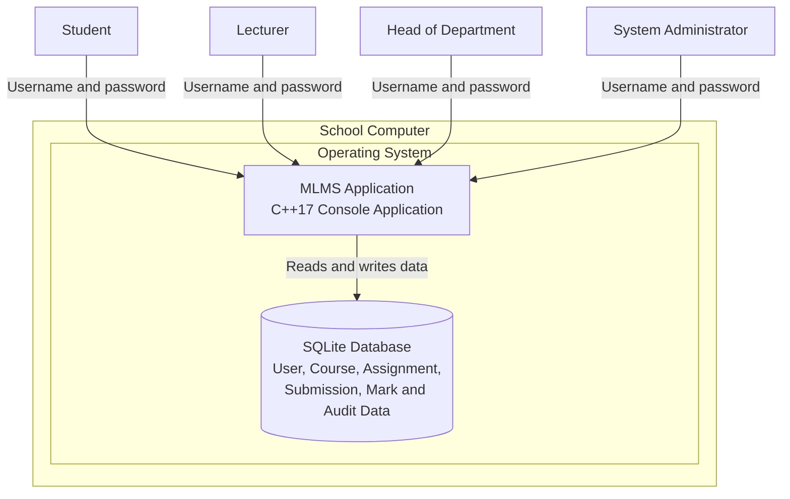

# MLMS UML Deployment Diagram

The diagram below shows how the MLMS application is deployed on a school computer. The application and SQLite database run locally, allowing the system to operate without an internet connection.

